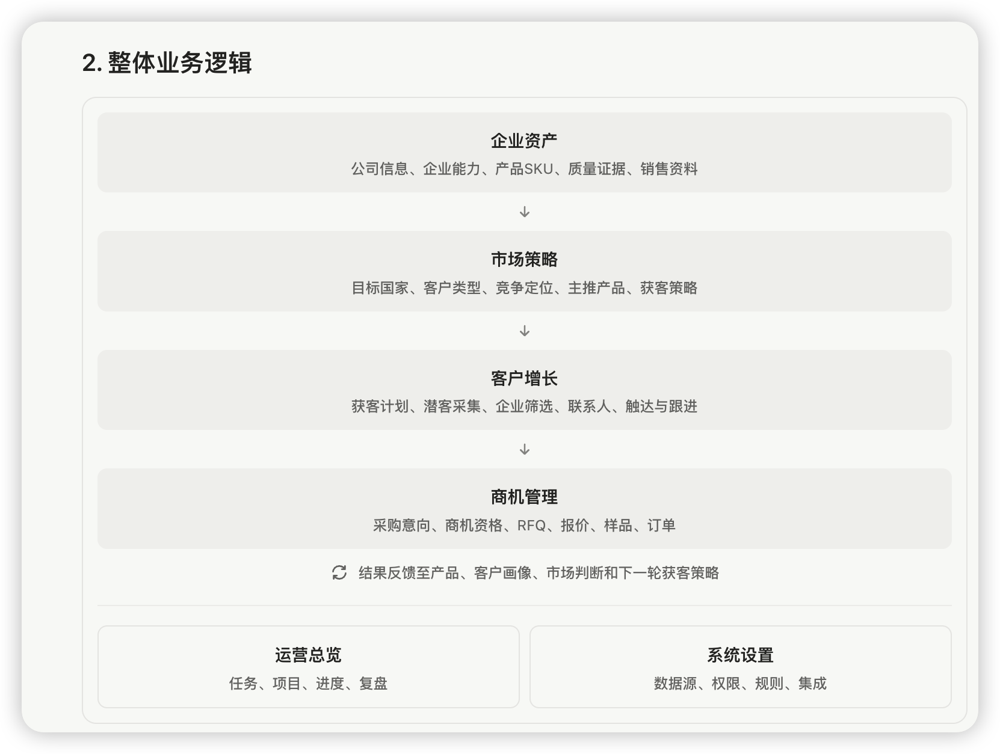

# ChatGPT 高保真可编辑导出器（Chrome Extension）
## 产品需求文档 PRD V1.0｜可直接交付 Claude Code 开发

> 文档状态：研发基线（2026-11-02）  
> 代号：ReplyCanvas（暂定，不要求沿用）  
> 产品形态：Chrome Manifest V3 扩展 + 扩展内部可视化编辑器 + 离线导出包  
> 首发支持：ChatGPT Web（chatgpt.com），Chrome 桌面版  
> 核心目标：在尽可能保留 ChatGPT 原始回答视觉效果的同时，使其中的文字、卡片、布局、矢量元素及可识别的图表内容可分别编辑。  
> 范围声明：本 PRD 不包含盗用账号、绕过网站限制、读取其他会话、上传用户私密内容或读取 ChatGPT 内部未公开数据的功能。

---

# 0. 给研发团队的执行摘要

这不是“ChatGPT 转 Markdown”或“截图导出”插件，而是**网页视觉结构捕获 + 可编辑元素模型 + 视觉校验 + 离线导出**产品。

必须采用“双轨保真”结构：

- **视觉轨**：采集用户选定回答的实际 DOM、布局、计算后样式、媒体资源与基准截图，尽最大可能实现渲染级复现。
- **语义/编辑轨**：将可理解的文字、容器、卡片、表格、SVG、箭头和图表对象转换为独立节点，供编辑器选择、修改、恢复和重新导出。
- 两条轨道要绑定到同一个稳定的节点 ID，任何编辑都能追踪原始节点与变更。
- 未能结构化识别的对象需要**明确降级**，而非伪装成完全可编辑对象。

**硬性禁止**：不得用“整条回答截图放进 HTML / SVG / Figma 画布”冒充可编辑输出；不得只靠 LLM 从截图重画并声称像素级无损；不得为追求导出效果读取用户未选择的对话内容。

# 1. 背景与问题

## 1.1 用户场景

用户在 ChatGPT 的聊天模式中看到包含精致布局的业务逻辑图或报告：卡片有圆角、不同层级的文字、灰色背景、间距、箭头及分栏。例如参考样例：

```
整体业务逻辑
  企业资产      公司信息 / 企业能力 / 产品 SKU / 质量证据 / 销售资料
      ↓
  市场策略      目标国家 / 客户类型 / 竞争定位 / 主推产品 / 获客策略
      ↓
  客户增长      获客计划 / 潜客采集 / 企业筛选 / 联系人 / 触达与跟进
      ↓
  商机管理      采购意向 / 商机资格 / RFQ / 报价 / 样品 / 订单
  ↻ 结果反馈至产品、客户画像、市场判断和下一轮获客策略
  ─────────────────────────────────────────────
  运营总览                                  系统设置
  任务 / 项目 / 进度 / 复盘                 数据源 / 权限 / 规则 / 集成
```

当前复制粘贴会损失视觉，截图失去编辑能力，普通 HTML/PDF 导出也可能丢失依赖样式与资源。

**视觉验收参考图（用户提供）：**



## 1.2 核心待解决问题

| ID | 问题 | 用户可感知后果 |
|---|---|---|
| P-01 | 普通复制只保留文本或部分 Markdown | 卡片、箭头、间距、配色消失 |
| P-02 | 截图精确保留外观但内容不可编辑 | 无法调整内容、样式和布局 |
| P-03 | 脱离原网页后 CSS、字体和图片资源缺失 | 本地 HTML 与 ChatGPT 原页面不一致 |
| P-04 | SVG/Canvas/特殊图表技术不统一 | 图表可能只能当成图片 |
| P-05 | 原生组件可能使用动态 DOM、Shadow DOM 或懒加载 | 截取遗漏内容、尺寸不准 |
| P-06 | 没有可量化的视觉质量验收 | 开发者主观认为“差不多” |

## 1.3 产品一句话价值主张

**选中一条 ChatGPT 回答 → 高保真捕获 → 在独立编辑器中编辑其元素 → 一键保存为可离线打开的编辑文件，并附带原始截图作视觉基准。**

# 2. 目标与非目标

## 2.1 必须达成（P0）

1. 用户明确选择**单条回答**，不默认捕获完整对话。
2. 捕获普通富文本、卡片、分栏、表格、箭头、内联 SVG、图片及常见 CSS 视觉属性。
3. 生成独立、可离线打开、可编辑的 HTML 工程；原有文本应能直接修改，结构化容器应可单独选中并编辑样式。
4. 生成结构化 `document.json`，记录元素树、节点映射、计算样式、资源信息、编辑能力等级和异常。
5. 生成可核对的**原始视觉 PNG**及导出页面 PNG；可在编辑器中左右对比、叠层比较。
6. 支持手动保存、重新打开、修改、撤销/重做、重新导出。
7. 支持 `.zip` 一键导出（至少 HTML、JSON、PNG、README 和 assets）。
8. 具有明确的成功、部分成功和失败状态，以及降级说明。
9. 默认完全本地运行，不调用外部服务器、不上传对话内容。

## 2.2 后续迭代（P1）

1. 对识别出的 SVG 图表元素进行逐项编辑；对于可验证的数据结构，增加数据表编辑。
2. 对复杂图形提供手动结构重建工具，并提供原图对照，而不是自动假定重建正确。
3. 多条回答批量导出和个人作品库。
4. 选定区域精确捕获（不局限于整条回答）。
5. 结构化 Figma 导出或通过配套 Figma 插件导入；验证层级、文字与样式而非只导出位图。

## 2.3 暂不包含（P2 / 明确非目标）

- 修改 ChatGPT 官方网页内的原始回答数据。
- 对任何 Canvas、WebGL、闭源交互图表保证自动恢复原始数据。
- 把任意复杂动画、3D、嵌入视频完整转换为可编辑的 Figma 原生对象。
- 绕过跨域权限、用户授权、字体授权或网站安全保护。
- 在 MVP 中支持所有 AI 网站、移动端 Chrome、Firefox、Safari。
- 直接编辑专有图表组件的内部运行状态或依赖未公开框架实例。

# 3. 用户与典型任务

**核心用户**：经常用 ChatGPT 生成流程图、信息卡、报告版面、方法论文档及知识卡片的高频知识工作者。

**JTBD**：

- 当 ChatGPT 产生一条视觉质量很高的回答，我希望不重新制作就能保存视觉效果。
- 当其中有文字或卡片需要更新，我希望直接改元素，而不是重新生成整页。
- 当我要把成果交给同事或未来继续使用，我希望可以离线打开、编辑并再导出。
- 当某一图表不可完整编辑时，我希望知道限制和原因，而非下载后才发现。

# 4. 产品原则与保真定义

## 4.1 三种保真层次

- **L1 外观保真（Visual Fidelity）**：像素、排版、样式、宽高、对齐、颜色接近原页面。
- **L2 结构保真（Structural Fidelity）**：文本节点仍为文本，卡片仍为独立容器，箭头仍为独立 SVG/形状，图片不是整页截图。
- **L3 语义保真（Semantic Fidelity）**：例如“图表的数值数据”“流程图的边关系”可作为真正的数据结构被修改。

P0 必须覆盖静态内容的 L1 + L2；对图表/复杂组件尽力覆盖 L2 并如实标记 L3 支持情况。L3 扩展为 P1 的重点。

## 4.2 编辑能力分级（必须在 UI 显示）

| 级别 | 标识 | 定义 | 代表对象 |
|---|---|---|---|
| E3 | 完全结构化可编辑 | 内容、布局、样式及结构数据可编辑 | 文本、普通卡片、识别出的简单流程图 |
| E2 | 图元级可编辑 | 可单独编辑图形元素，但原始语义数据可能未知 | 独立 SVG 路径/文本、SVG 图表 |
| E1 | 有限可编辑 | 容器及覆盖文本可编辑，核心渲染仍是位图 | 不可解析 Canvas、外部复杂挂件 |
| E0 | 只读视觉保留 | 仅安全保留截图或占位，明确不可编辑 | 跨域限制图形、无法读取的嵌入对象 |

**关键约束**：E1/E0 项不得计入“完全可编辑节点占比”，不得用浮层覆盖一张截图来掩盖底层不可编辑。

# 5. 核心流程与信息架构

## 5.1 端到端主流程

```
安装扩展
  → 打开 ChatGPT 对话
  → 点击扩展图标 / 激活「选择回答」
  → 鼠标悬浮高亮可选回答
  → 用户确认选定一条 Assistant 回答
  → 展示捕获范围、主题、宽度和文件名
  → 执行预检（资源可用性、布局稳定、复杂节点）
  → 捕获原貌（DOM + Computed CSS + 素材 + 视觉基准）
  → 结构化解析与编辑能力评估
  → 打开编辑器（对比 / 图层树 / 属性面板）
  → 编辑、撤销、预览、校验
  → 导出 ZIP / HTML / JSON / PNG
  → 本地离线重开，继续编辑
```

## 5.2 页面组成

1. **扩展入口 Popup**：当前网站支持状态、选择回答、最近一次捕获、设置。
2. **网页选择层 Overlay**：选择高亮、单条回答边界、确认/取消、操作不干扰原页面。
3. **捕获进度浮层**：步骤显示（分析/样式/素材/截图/构建）；可取消。
4. **编辑器（独立扩展标签页，优先于狭窄侧边栏）**：上方命令栏；左侧图层树；中央真实尺寸画布；右侧属性面板；下方质量及异常列表。
5. **导出对话框**：格式勾选、目标尺寸、资产离线化状态、编辑等级统计、提醒。
6. **项目打开页面**：导入本工具生成的 ZIP / JSON 工程，恢复编辑状态。

# 6. 功能需求（FR）

## FR-01 站点识别与权限（P0）

- 默认仅支持 `https://chatgpt.com/*`，版本内维护可测试的 host adapter。
- 首次由用户主动点击扩展后，通过 `activeTab` + `scripting` 临时注入；避免默认声明 `<all_urls>`。
- 只扫描当前活动标签页的回答节点，不后台轮询全部对话。
- 页面结构变化时显示“无法定位回答”并提供手动框选回退；不得悄悄抓取整个页面。

**验收**：普通对话能区分用户消息与 Assistant 回复；选中后只产生指定回答的节点集，不包含侧边栏、输入框、其他回答。

## FR-02 回答选取（P0）

- 激活后 Hover 出细边框，展示“导出此回答”按钮。
- 点击选择后再次确认范围；支持“仅回答主体”与“包含标题/引用/图片”勾选。
- 对长回答、折叠内容、懒加载显示预检提示；仅导出页面实际可访问且用户授权选择的内容。
- 在未提交导出前，支持重新选择。

**验收**：样例同一对话有 5 条回答时仅选择 1 条；不会误加用户提问或底部交互工具条。

## FR-03 高保真 DOM 捕获（P0）

- 递归遍历目标 DOM，保留元素标签、文本、节点层级、语义角色、子节点顺序及可见性。
- 采集 `getBoundingClientRect()`、padding/margin、border/radius、display/flex/grid、gap、position、transform、opacity、overflow、text styles、colors、backgrounds、shadows、pseudo-elements 等可用**计算样式**。
- 为每个原节点与副本生成稳定 `nodeId`，保持源节点与编辑节点映射。
- 处理 CSS 自定义属性、`::before`/`::after` 的可呈现内容，避免只复制 className 但丢失上下文 CSS。
- 对 Shadow DOM：可访问的 open shadow root 尝试递归捕获并记录样式；closed shadow root 标记限制并走降级路径。
- 保留原始容器宽度、viewport、DPR、缩放比例、色彩主题；编辑器默认“按原尺寸展示”，避免自适应重排。
- 对固定定位、粘性定位及滚动容器，创建独立局部坐标系并测试定位还原。
- 不自动改写原页面 DOM；如截图需要临时状态调整，必须可回滚并在异常时恢复。

**验收**：参考业务逻辑图中四个纵向卡片、箭头、反馈区域和两个底部卡片分别映射到独立元素树；文字仍为文本对象。

## FR-04 样式与资源固化（P0）

- 将本次导出所需样式固化到隔离作用域，优先生成 scoped CSS + 必要内联 computed styles；不依赖 ChatGPT 源站在线加载。
- 图片、SVG、CSS background、`` 源、可合法获取的字体等加入 `assets/` 并更新相对引用；支持常见 data URL/blob URL 的安全转存。
- 外部字体无法合法打包时只记录字体栈并采用系统 fallback，同时在验收面板显示可能存在文字尺寸误差。
- 字体、图片、SVG 等资产必须记录来源、哈希、大小、保存状态与失败原因。
- 避免把聊天页面脚本、鉴权标识、Cookie、token、隐含页面状态等写入导出包。

**验收**：断网打开生成的 `index.html`，本地样例文本、卡片、颜色、箭头及资源仍可显示；不得向源站发起必要依赖请求。

## FR-05 视觉基准截图（P0）

- 在改变原回答之前保存基准 PNG；截图必须对应选中的回答而非全浏览器窗口。
- `chrome.tabs.captureVisibleTab` 可作为可视区域截图来源，但它**不是完整节点截图 API**；对于超出 viewport 的长回答，必须实现可验证的滚动分段 + 坐标拼接，或给出可靠的用户可见限制。
- 截图操作需控制 Chrome 的频率限制并防止页面滚动引起的重影；临时隐藏悬浮控制层。
- 截图元信息：目标 DOM rect、viewport、DPR、缩放、滚动偏移、尺寸和捕获时刻。
- 如不能得到完整视觉基准，不得标记“完整捕获成功”。

**验收**：参考样例截图的布局被单独截取，无浏览器工具栏、无其他对话；长回答测试无重复拼接行。

## FR-06 结构化编辑器（P0）

- 中央画布支持缩放（25%–200%）、原尺寸、适配画布、平移与对照模式。
- 左侧图层树：文字/容器/图表/SVG/图片/形状；可展开、搜索、选择、隐藏和锁定；展示 E3–E0 编辑能力。
- 右侧属性面板至少支持：文本内容、字体、字号、字重、行高、文字颜色、对齐、宽高、padding/margin、背景、圆角、边框、阴影、flex/grid gap、可见性。
- 文本直接双击编辑；支持文本换行后重排，提示可能导致的视觉偏移。
- 卡片可单选、移动、调整尺寸与背景属性；支持容器嵌套关系，不可退化成无关联的绝对定位碎片。
- 实现 Undo / Redo（至少 50 个操作）；修改前后预览，恢复原始样式。
- 编辑器本身不得执行捕获页面中的任意脚本；加载内容必须经过安全处理。

**验收**：用户可以修改示例中“市场策略”为“市场定位”，独立调整第二张卡片圆角和背景，并恢复原始视觉；不会误改其他卡片。

## FR-07 流程图、SVG 与图表（P0 / P1）

**P0**
- 普通流程图中的独立文本、容器、SVG 箭头和线条应映射为对应编辑节点，单独修改。
- 原始 SVG 能够隔离保存，暴露可编辑的文本、基础形状、路径、颜色、尺寸、stroke 等属性（属于 E2，除非有更高语义结构）。
- 检测 `<canvas>`、WebGL、外部 iframe、复杂运行时组件，并标记能力等级与可能失真的风险。
- Canvas 无语义数据时允许视觉快照 E1/E0，但必须显示“图表原始数据不可直接恢复”。

**P1**
- 为明确识别且可验证的数据型图表提供适配器（按 chart type + data schema 接口设计）。
- 支持柱状、折线、饼图的结构化再编辑：系列、类别、数值、颜色、坐标轴、图例。
- 对无法可靠识别的数据图表提供“手动重建为可编辑图表”，保留原始图作为核对基准。
- 不允许通过高风险地读取 React 私有 Fiber、全局内部 store 或认证接口来强行提取数据。

**验收**：至少一个 SVG 绘制的流程图可独立编辑箭头和节点标签；一个原生 Canvas 图表如不能恢复数据，必须清晰显示 E1/E0 和原因，不得声称完全可编辑。

## FR-08 本地工程与重开（P0）

- 编辑状态通过结构化工程数据保存，所有用户改动必须可序列化。
- `document.json` 使用固定 schema version；提供迁移器的扩展点。
- 支持从导出 ZIP 内 `document.json` + assets 导入并恢复节点树、布局、文本、样式与编辑历史的最终结果。
- 自动保存优先使用 IndexedDB（限当前设备），但不强制启用；提供“删除本地项目”功能。

**验收**：关闭编辑器重开工程后，修改过的文字与卡片样式一致；图片、字体等资源在断网状态可用。

## FR-09 导出（P0）

- **默认 ZIP**：`index.html`（离线展示/可编辑入口）、`document.json`、`reference.png`、`rendered.png`、`assets/`、`manifest.json`、`README.md`。
- 单独导出：HTML、JSON、PNG（P0）；PDF（P1，可由离线页面打印）；Figma（P1）。
- 生成的 HTML 可单独预览，且工程中的文字/卡片保持 DOM 独立结构；直接双击 HTML 可进入至少基础内容编辑模式（或提供明确的“打开编辑器”方式；不能假称单 HTML 具备完整编辑器）。
- 若包含需要外部 assets 的资源，单个 `index.html` 要么做到自包含，要么明确提示需与 `assets/` 一起使用。
- 导出文件名默认：`ChatGPT回答_YYYYMMDD_HHMM`，支持用户修改。
- 所有导出格式必须带有对象可编辑性摘要。

**验收**：下载后完全断网，在 Chrome 打开导出工程无空白、资源断链、脚本异常；文字依然是实际 text nodes，卡片依然是独立容器。

## FR-10 视觉对比与质量反馈（P0）

- 参考截图与重建截图同宽、同 DPR、同主题、同 viewport 配置下比较。
- 视图：左右对比、50% 叠层、差异热区。
- 指标至少包含：截图尺寸一致性、文字内容一致性、关键元素矩形偏差、像素差异比例及资源缺失统计。
- 自动生成质量报告，标注造成偏差的节点与可能原因（字体、图片、截断、overflow、Shadow DOM 等）。
- 不能因为结构转换失败而保留原图并宣称质量通过，必须分别展示 L1/L2/L3。

## FR-11 状态与错误反馈（P0）

状态：`idle` → `selecting` → `prechecking` → `capturing` → `normalizing` → `validating` → `ready` / `partial` / `failed` / `cancelled`。

每个状态必须有可见进度、可取消操作、恢复原网页策略；异常应可查看“技术详情”，不得仅显示“导出失败”。

## FR-12 设置（P0）

- 默认主题继承源回答主题（亮色/暗色）。
- 默认包含资源与基准 PNG；默认不含 ChatGPT 对话上下文或侧边栏。
- 允许选择导出路径（通过浏览器下载能力，非静默写任意系统路径）。
- 隐私开关默认开启：本地处理、无遥测、无外部上传。

# 7. 页面级交互规格

## 7.1 插件 Popup

- 当前站点：支持 / 不支持。
- 主按钮：`选择 ChatGPT 回答`；未授权时解释临时访问目的。
- 次按钮：`打开本地项目`、`设置`。
- 不需要账号系统、注册或服务器。

## 7.2 回答选择模式

- 鼠标经过回答容器：显示高亮轮廓，不改变原布局。
- 顶部小浮层：`导出此回答`、`取消`。
- 已选回答弹层：显示估算节点数、图片/图表数量、预计复杂度；用户单击 `开始捕获`。
- 若页面中使用多个嵌套滚动区域或特殊画布组件，捕获前提示可能不完整。

## 7.3 编辑器结构

```
┌──────────────────────────────────────────────────────────────┐
│ 项目名   [撤销][重做]   [原尺寸][对比][差异]  [导出 ZIP]      │
├──────────────┬───────────────────────────┬───────────────────┤
│ 图层树        │       编辑画布             │ 属性 / 样式         │
│ ▸ 标题        │  与 ChatGPT 对应的页面布局   │ 文本 / 字体         │
│ ▸ 卡片 01     │  选中卡片显示控制柄         │ 填充 / 边框         │
│ ▸ 卡片 02     │  选中文字可直接修改         │ 圆角 / 尺寸         │
│ ▸ 箭头        │                           │ 布局 / 对齐         │
│ ▸ 底部分栏     │                           │ 编辑能力 E3/E2..   │
├──────────────┴───────────────────────────┴───────────────────┤
│ 质量：视觉差异 xx% | E3 节点 xx% | 警告 N 项 | 资源失败 N 项     │
└──────────────────────────────────────────────────────────────┘
```

- 顶部不得用夸张视觉特效干扰原文对照；以可读、专业、低负担的编辑器风格为主。
- 编辑器中基准截图仅用于对比，不得作为编辑内容的唯一实体。

# 8. 技术架构（给 Claude Code 的工程基线）

## 8.1 建议技术栈

| 层 | 建议 | 原因 |
|---|---|---|
| Chrome 扩展 | Manifest V3 + TypeScript | 当前 Chrome 标准架构，较易维护 |
| UI | React + TypeScript + Vite | 编辑器状态与组件组织 |
| 编辑状态 | Zustand（可换等价实现） | 低耦合操作、撤销/重做 |
| DOM 捕获 | Content Script + 原生 DOM API | 直接采集真实渲染结构 |
| CSS 处理 | Computed Style Collector + CSS serializer | 视觉保真 |
| 素材管理 | Blob / ArrayBuffer + 资源 Manifest | 离线化与可追踪 |
| 文件打包 | JSZip 或等价本地打包库 | 一键 ZIP |
| 本地持久化 | IndexedDB | 大体积工程离线保存 |
| 图表 | SVG parser + 可扩展 adapter interface | 分阶段实现图元/数据编辑 |
| 截图/质量 | Chrome screenshot API + Playwright 测试端 | 实证比较 |
| 测试 | Vitest + Playwright + Chrome extension E2E | 单元、回归、真实流程 |

以上为建议，不强制依赖特定库，但必须说明替换依据与兼容性。

## 8.2 组件分层

```
[Chrome Popup / Action]
        ↓ 用户主动授权
[ChatGPT Host Adapter]
   - 识别 Assistant 回答
   - 单条选取和高亮
   - 节点捕获范围确认
        ↓
[Capture Pipeline]
   ├─ DOM Walker / Shadow Root Handler
   ├─ Geometry + Computed Style Collector
   ├─ SVG / Canvas / Media Classifier
   ├─ Resource Resolver + Local Asset Store
   └─ Baseline Screenshot Capture
        ↓
[Canonical Document Model]
   - nodes + relationships + styles
   - editableCapability + warnings
   - assets + source mappings
        ↓
[Editor Renderer / Layer Tree / Inspector]
        ↓
[Visual Validation Engine]
        ↓
[HTML / JSON / PNG / ZIP Exporters]
```

## 8.3 MV3 权限与执行环境

- 基础权限建议：`activeTab`, `scripting`, `downloads`, `storage`；使用扩展内编辑器即可，无须强制 `sidePanel`。
- 只有在真实需要进行 Blob 操作且主上下文不适合时启用 `offscreen`；Service Worker 不具有 DOM。
- 尽量通过用户点击注入 isolated content script；默认不使用 `MAIN` world。若必须使用 `MAIN`，需列出具体必要性、安全边界及用户可感知结果。
- 不请求 `<all_urls>`、`cookies`、`webRequest`、`debugger` 等宽权限作为默认实现。
- Manifest V3 不允许远程托管可执行代码，依赖应本地打包。
- DOM 捕获算法必须可通过夹具运行，不得与 ChatGPT 临时 className 紧耦合。

参考官方文档：
- https://developer.chrome.com/docs/extensions/reference/api/scripting
- https://developer.chrome.com/docs/extensions/reference/api/tabs
- https://developer.chrome.com/docs/extensions/reference/api/downloads
- https://developer.chrome.com/docs/extensions/reference/api/offscreen
- https://developer.chrome.com/docs/extensions/develop/migrate/what-is-mv3

## 8.4 DOM 捕获策略

**原则：先生成静态高保真 DOM 快照，再生成可编辑规范模型；不要直接让截图替代 DOM 模型。**

步骤：

1. Resolve：找到用户选定的唯一回答根元素，写入 `sourceFingerprint`。
2. Stabilize：等待字体与图片在可配置窗口内稳定；对持续动画进行受控快照。
3. Snapshot：遍历 visible DOM，采集 tag/text/attributes/computed styles/rect/pseudo 和 CSS 变量解析结果。
4. Resources：提取可合法获取的媒体，去重存为离线资产；失败则保留 warning。
5. Normalize：生成独立 CSS 作用域与语义节点，过滤 ChatGPT 操作按钮与无关 UI。
6. Classify：为每个图元赋予 E3/E2/E1/E0，绝不默认为 E3。
7. Render：在隔离编辑 iframe / shadow-root 容器中重建，禁止执行捕获页面脚本。
8. Compare：和 baseline 图逐像素/几何比较；记录问题。

禁止拷贝聊天页面中的 `script` 标签、事件处理器、token、表单敏感数据、页面存储或框架内部密钥。

## 8.5 可编辑 HTML 的实现方式

- 生成离线展示 `index.html` + 结构化数据；HTML 中的文字仍为 DOM text，容器仍为独立 HTML 元素。
- 编辑器通过 `nodeId` 修改规范模型，再 patch 对应 DOM，避免遍历后丢失映射。
- CSS 必须隔离命名空间，防止 ChatGPT/浏览器样式与编辑器互相影响。
- 支持基础 `contenteditable` / inspector 编辑；富文本数据模型应维护 text runs，避免原始 `<span>` 属性被破坏。
- 为长期维护保留必要的 flex/grid 语义，避免简单地把所有节点绝对定位；特例可使用绝对定位但必须标记。

# 9. 数据结构与协议

## 9.1 Canonical Document Model（示例）

```json
{
  "schemaVersion": "1.0.0",
  "documentId": "uuid",
  "title": "整体业务逻辑",
  "source": {
    "site": "chatgpt.com",
    "originUrl": "https://chatgpt.com/…",
    "selectedMessageFingerprint": "sha256:…",
    "capturedAt": "2026-11-02T08:00:00Z",
    "viewport": { "width": 1440, "height": 900, "dpr": 2, "zoom": 1 },
    "theme": "light"
  },
  "rootNodeId": "n-root",
  "nodes": [
    {
      "id": "n-card-market",
      "parentId": "n-root",
      "kind": "container",
      "tag": "div",
      "children": ["n-title-market", "n-desc-market"],
      "layout": { "display": "flex", "direction": "column" },
      "rect": { "x": 12, "y": 170, "width": 980, "height": 90 },
      "style": { "backgroundColor": "#f1f1ef", "borderRadius": "12px" },
      "editability": "E3",
      "sourceMap": { "domPathHash": "sha256:…" }
    },
    {
      "id": "n-title-market",
      "parentId": "n-card-market",
      "kind": "text",
      "text": "市场策略",
      "style": { "fontSize": "22px", "fontWeight": 600 },
      "editability": "E3"
    }
  ],
  "assets": [],
  "warnings": [],
  "quality": { "visualScore": null, "structuralScore": null },
  "revisions": []
}
```

要求：

- `schemaVersion` 及迁移扩展点必备。
- `source.originUrl` 为敏感来源信息；导出前允许用户清除或匿名化，默认不收集聊天内容之外的信息。
- `warnings` 包含类型、节点、严重程度、用户可读原因、自动或手动解决建议。
- 编辑能力和视觉质量分开存储，不能用单一分数掩盖缺陷。
- 原始对话 ID、认证 token 不得成为工程必填字段。

## 9.2 资源 Manifest

每条记录含 `id, sourceType, mimeType, sha256, relativePath, resolved, fallbackUsed, sizeBytes, warningCode`；同一哈希的图片去重。

## 9.3 输出文件结构

```
ReplyCanvas_整体业务逻辑_20261102_1600.zip
├── index.html             # 离线展示；文字和容器为独立元素
├── document.json          # 节点树、样式、编辑状态、图表能力等级
├── manifest.json          # 版本、资源校验、完整性、质量摘要
├── reference.png          # 原始 ChatGPT 节点视觉截图
├── rendered.png           # 导出文档的对应尺寸截图
├── assets/                # 图片、可合法打包的字体、SVG 等
│   └── ...
└── README.md              # 打开方式、编辑方式、已知降级和风险
```

# 10. 视觉质量标准与验收方法

## 10.1 基础测试条件

- 使用固定 Chrome 版本、操作系统、viewport、deviceScaleFactor、100% 浏览器缩放、相同主题、字体配置。
- 对比时使用**捕获前原始基准 PNG**，不能与自己重建的截图比较并宣称成功。
- 测试仅比较同尺寸裁剪区域；排除可明确解释且已经登记的动态时间戳/闪烁光标。

## 10.2 MVP 量化门槛（针对受控测试夹具，不承诺全部网页）

| 维度 | P0 验收线 | 判定方法 |
|---|---|---|
| 文本完整性 | 测试夹具可见文本 100% 一致 | 文本节点抽取与 diff |
| 节点可编辑 | 夹具中普通文本、卡片、容器 100% 能独立选中与修改 | 自动化编辑并重开 |
| 视觉保真 | 受控静态 DOM 夹具 SSIM ≥ 0.97；关键业务逻辑图人工核验通过 | 原图 vs 重建图 |
| 几何偏差 | 重要卡片边界误差 ≤ 2 CSS px（受控环境） | Rect diff |
| 资源完整 | 无缺失的关键离线图片/SVG 资源 | 断网重开检查 |
| 数据可追踪 | 100% 节点都有编辑能力标识和唯一 ID | JSON schema 验证 |
| 诚实降级 | 100% 不可还原 Canvas / closed Shadow 组件均标注原因 | 边界用例测试 |
| 回归可复现 | 每次修复附带截图 diff 和测试结果 | CI 报告 |

SSIM 不是唯一质量判断：即使得分高，只要关键文字、箭头或卡片内容遗漏，仍不得通过。

## 10.3 评测矩阵（至少 12 个夹具）

T01 纯文字多段落；T02 标题/列表/加粗/链接；T03 表格；T04 圆角卡片与灰底；T05 flex/grid 双栏；T06 箭头和内联 SVG；T07 高于屏幕的长回答；T08 深色模式；T09 公式/代码块；T10 图片与背景图；T11 SVG 数据图；T12 Canvas 图/跨域 iframe/不可访问 Shadow DOM。

**必须包含用户参考图的同构验收夹具**：4 个主流程卡片 + 3 个向下箭头 + 1 个反馈区 + 2 个底部卡片。真实 ChatGPT 网页的对应回答属于最终手工 E2E 必测，不得只用本地模拟页面替代。

## 10.4 编辑后验收

步骤：导入示例 → 修改“市场策略”文字 → 调整其背景颜色、圆角和间距 → 保存 ZIP → 新窗口断网打开 → 恢复编辑 → 撤销 → 再次导出。各步骤不得丢失其他组件、字体或布局关系。

# 11. 性能与可靠性

- P0 在 1000 个可见节点以内的受控样例中，用户点击捕获到可预览的目标 P95 ≤ 10 秒；性能低的设备或资产较大时允许超时但必须提示。
- 编辑操作的反馈目标 P95 ≤ 100ms（不包括完整视觉截图重算）。
- 对大于 10MB 的图片/大 DOM 显示进度及内存风险；支持用户主动取消。
- 捕获进程异常必须能移除 overlay、恢复滚动位置和 CSS 临时变更。
- Service Worker 被挂起后可恢复可重试阶段；大体积数据不能仅放在 worker 内存中。
- 重复点击导出不得产生竞态或破损 ZIP。
- 有资源失败时输出 `partial`，不应返回 `ready`。

# 12. 隐私、安全与合规

1. 用户显式选择才采集；只处理选中回答内容，不扫描其他聊天或账号资料。
2. 默认本地处理、无账号、无服务端、无分析遥测、无外部 API 调用；后续云功能必须另行明示同意。
3. 不保存 Cookie、Token、localStorage、sessionStorage、用户未选内容、页面请求头。
4. 对导入/导出的 HTML 做 sanitize：移除可执行 script、事件属性、危险 URL、嵌入式任意脚本；预览使用隔离上下文与严格 CSP。
5. 所有外部 URL 引用必须有资源白名单/协议校验；防止 `javascript:`、不安全 data scheme 和资源注入。
6. 资源下载仅为所选内容实际使用的资产，不执行任意跨域探测或绕过浏览器策略。
7. 提供“清除本地工程数据”功能，以及“导出前移除源 URL/时间”等元信息选项。
8. 不复制第三方字体或受限媒体的二进制文件，除非能合法打包；否则回退并提示。
9. 出口 HTML 必须可在离线情况下安全打开；不依赖 ChatGPT 会话认证。
10. Chrome Web Store 的权限说明、数据使用说明应与真实行为一致。

# 13. 开发阶段与交付工单

## M0｜技术验证门槛（Spike）

**目标**：先证明“选中单条回答 + 抓取真实布局 + 离线重现 + 可编辑文本/卡片”可成立。

- DEV-001：MV3 扩展空工程、构建与测试框架。
- DEV-002：ChatGPT 单条 Assistant 回答 adapter；网页 hover/选择 overlay。
- DEV-003：针对业务逻辑图样例的 DOM + computed CSS 快照 PoC。
- DEV-004：原始节点 PNG 截取 PoC；长页面截取边界记录。
- DEV-005：导出独立 HTML 并对比真实截图；输出关键差异。
- DEV-006：实现文本与卡片的独立修改证明。

**通过门槛**：有真实 Chrome 页面端到端演示、真实截图对照、明确列出的不能还原部分。否则禁止开始堆叠编辑器 UI。

## M1｜MVP 可用闭环（P0）

- DEV-101：规范 DocumentModel、节点 ID、schema 校验、版本与映射。
- DEV-102：CSS serializer、pseudo elements、布局坐标系统。
- DEV-103：素材固化、路径重写、资源 manifest 和异常分级。
- DEV-104：完整节点截图/局部截图拼接及元信息。
- DEV-105：编辑器画布、图层树、属性面板、文本/卡片编辑。
- DEV-106：撤销重做、状态持久化、工程导入导出。
- DEV-107：ZIP / HTML / JSON / PNG 导出与断网运行。
- DEV-108：原始/重建视觉对比、自动差异报告。
- DEV-109：E3/E2/E1/E0 分类与安全降级。
- DEV-110：安全审计、异常回滚、安装说明、测试用例。

**通过门槛**：完成第 10 节验收矩阵；真实业务逻辑图能完成“捕获→单卡片编辑→导出→断网重开→视觉对比”的全过程。

## M2｜高级编辑与兼容（P1）

- DEV-201：SVG 图元编辑优化（路径、箭头、标签、组）。
- DEV-202：可验证图表适配器及数据表编辑。
- DEV-203：复杂图表手动重建和原图核对。
- DEV-204：多回答批量和历史项目管理。
- DEV-205：Figma 结构化导出路径的可行性验证与实施。
- DEV-206：ChatGPT UI 变更回归适配机制。

## 开发顺序原则

先“捕获正确”→“离线视觉复现”→“局部可编辑”→“可靠导出”→“图表语义与 Figma”。

**不得**先做一个漂亮但依赖静态截图的编辑器，再宣称满足核心功能。

# 14. 项目交付物与验收责任

Claude Code 每个阶段应交付：

1. 可运行源代码及 README（安装、调试、打包、浏览器权限）。
2. `dist/` 可在 `chrome://extensions` 以“加载已解压的扩展程序”方式运行。
3. 自动测试及真实浏览器 E2E 测试脚本、覆盖范围说明。
4. 真实示例的 `reference.png`、`rendered.png`、差异报告。
5. 覆盖用户参考样例的工程 ZIP，以及编辑前后示例。
6. 已知限制和功能能力矩阵（E3/E2/E1/E0）。
7. 权限清单、隐私/安全检查清单、第三方依赖许可证清单。
8. 版本、提交 SHA、变更记录和阻塞项。

**质量门槛**：只报告实际运行的测试结果；不能编造已通过的 UI E2E、视觉对比或断网测试。涉及无法自动验证的 ChatGPT 页面变化必须写出手工复现步骤。

# 15. 风险清单与应对

| 风险 | 级别 | 应对 |
|---|---|---|
| ChatGPT DOM 与 UI 改版 | 高 | Adapter 隔离；选择器回归；手动框选回退 |
| 动态组件并不公开内部数据 | 高 | E0–E3 明确分级；优先图元级；后续手工重建 |
| 跨域图片/字体/iframe 资源限制 | 高 | 离线状态报告、合法资源路径、明确降级 |
| 长回答截图的滚动拼接错误 | 中高 | 固定环境、滚动容器识别、坐标校准、视觉测试 |
| 非标准 CSS / Shadow DOM | 中高 | computed CSS + 明确兼容矩阵；闭合根降级 |
| 编辑后布局变化导致溢出 | 中 | 显示偏差报警、约束布局编辑和恢复原始布局 |
| 采集私人内容的隐私风险 | 高 | 仅主动单条选取、默认本地、不外传、元信息匿名化 |
| 网页结构复制携带 XSS | 高 | 严格 sanitize、CSP、脚本禁用、隔离预览 |
| 特定字体无法授权打包 | 中 | fallback + 视觉误差提示，不非法复制 |
| Figma 转换不保留原始语义 | 中 | P1 独立验收，不影响 P0 闭环 |

# 16. 最终产品验收（Go / No-Go）

**全部为强制项**：

- [ ] 在真实 ChatGPT 网页中，明确选定单条 Assistant 回答，不误选其他内容。
- [ ] 参考业务逻辑图中所有可见文字内容完整保留。
- [ ] 四个主卡片、箭头、反馈区、底部两卡片均为独立对象或明确登记的 SVG 图元组。
- [ ] 修改一张卡片不会意外改变其余卡片。
- [ ] 能修改文字、背景、边框圆角、间距，支持撤销/重做。
- [ ] 导出 HTML/JSON/PNG/ZIP，断网打开后仍可查看，并可从工程恢复编辑。
- [ ] 原图与重建图有真实可查的对比证据，达到受控夹具门槛。
- [ ] Canvas 等复杂对象标注真实可编辑等级，无截图冒充结构化编辑。
- [ ] 没有未经授权访问其他对话、上传数据或泄露令牌。
- [ ] Chrome MV3 扩展可真实加载、操作、捕获、编辑和导出；无阻断级报错。

未满足任意强制项应定性为 `REWORK`，不得标注项目“完成”。如技术上无法实现，应提交证据、影响范围和可替代方案，并将相应验收项明确变更，不能暗中降低标准。

# 17. Claude Code 启动指令（可直接复制）

```text
请严格按照随附《ChatGPT 高保真可编辑导出器 PRD V1.0》开发 Chrome Manifest V3 扩展。

你需要首先完成 M0 技术验证，不要先堆叠 UI，也不要用截图或 AI 重画冒充可编辑 DOM。
核心链路：用户选定单条 ChatGPT Assistant 回答 → DOM/Computed Style/资源/基准截图采集 → 规范化节点模型 → 独立 HTML 复现 → 文本与卡片可编辑 → 与原截图视觉比较。

技术决策务必优先满足：
1. 视觉保真与结构可编辑分别验收；所有节点清楚标记 E3/E2/E1/E0。
2. 只获取用户明确选择的回答，默认本地执行且无网络上传。
3. MV3 最小权限，处理安全清洗、离线资源、异常恢复。
4. 以用户示例业务逻辑图为核心场景；请同时制作受控 DOM 夹具，并在能接触真实 ChatGPT 页时进行真实 E2E 验证。
5. 每阶段交付实际可运行代码、测试输出、真实截图对比、失败项目及待修复计划。
6. 如某项因浏览器/网页技术限制无法达到 100%，必须明确记录，不得虚报完全可编辑或完美还原。

先提交：
A. 仓库目录结构和关键模块接口；
B. M0 拆分工单、实现方案与测试设计；
C. M0 最小可运行原型和真实证据；
通过 M0 门槛后依 PRD 推进 M1，最终交付可安装扩展及可编辑离线工程示例。
```

# 18. 技术依据与附录

官方 Chrome 扩展文档（2026-11-02 查阅）：

1. Scripting API：https://developer.chrome.com/docs/extensions/reference/api/scripting
2. Tabs 截图与活动标签权限：https://developer.chrome.com/docs/extensions/reference/api/tabs
3. Downloads API：https://developer.chrome.com/docs/extensions/reference/api/downloads
4. Offscreen API：https://developer.chrome.com/docs/extensions/reference/api/offscreen
5. Manifest V3 机制：https://developer.chrome.com/docs/extensions/develop/migrate/what-is-mv3
6. Side Panel API（可选）：https://developer.chrome.com/docs/extensions/reference/api/sidePanel
7. 扩展安全：https://developer.chrome.com/docs/extensions/develop/migrate/improve-security

**技术提醒**：Chrome API 与 ChatGPT Web DOM 会发生版本变化。开发阶段应以当时实际 Chrome 版本、网站实际渲染结构与自动化测试为准；本 PRD 是产品与验收基线，不是对每类组件实现 100% 无损转换的技术保证。
